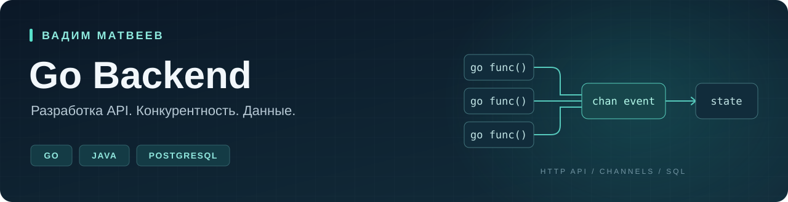

  

  <a href="mailto:l0gik67@mail.ru">Email</a> &nbsp; · &nbsp;
  <a href="https://t.me/l0gik67">Telegram</a> &nbsp; · &nbsp;
  <a href="https://github.com/l0gik67?tab=repositories">Репозитории</a>

## Привет, я Вадим

Развиваюсь в **Go backend** и ищу стажировку. Прошёл трёхмесячную стажировку Java Backend в **Яндексе / Кинопоиске**. Сейчас пишу учебные проекты на Go: от конкурентной обработки событий до HTTP API с PostgreSQL.

Учусь на 3-м курсе бизнес-информатики в Санкт-Петербургском политехническом университете.

## Проекты

### [MiningGame](https://github.com/l0gik67/MiningGame)
**Конкурентность в Go на примере угольной шахты**

Игра с HTTP API: шахтёры добывают уголь в отдельных горутинах, а события по каналам поступают в общий обработчик предприятия. Игрок нанимает шахтёров и покупает оборудование.

- Горутины, каналы и интерфейс `Miner` для трёх классов шахтёров.
- Остановка через `context`, ожидание завершения через `WaitGroup`, синхронизация общего состояния через `RWMutex`.
- HTTP API, валидация JSON и тесты игровой логики, обработчиков и конкурентных сценариев.

`Go` `net/http` `gorilla/mux` `context` `sync`

### [stuffRegistry](https://github.com/l0gik67/stuffRegistry)
**HTTP API учёта сотрудников · в разработке**

Создание, получение списка и удаление сотрудников с хранением в PostgreSQL. Параметризованные SQL-запросы, пул соединений `pgxpool`, SQL-миграции и валидация входных данных.

В локальной версии добавлены Dockerfile, Compose и команды Makefile. Compose запускает приложение; база данных подключается отдельно. Основной код опубликован; Docker-конфигурация пока находится в локальной версии.

`Go` `PostgreSQL` `pgx` `Docker Compose` `Makefile`

### [go-todo-cli](https://github.com/l0gik67/go-todo-cli)
**Консольный менеджер задач**

Добавление, завершение и удаление задач, проверка команд и журнал событий. Учебная практика структур, методов, map, срезов и обработки ошибок. Данные хранятся в памяти.

`Go` `CLI` `in-memory`

## Опыт

**Яндекс / Кинопоиск — стажёр Java Backend**  
Июнь — сентябрь 2026 · команда доступности фильмов и лицензирования контента

- Предложил подход к поддержке нового типа подписки и реализовал изменения в **7 микросервисах**. Написал интеграционные тесты, запустил свою часть изменений под feature flag и следил за метриками.
- В **2 микросервисах** прекратил параллельную запись в старую БД и удалил зависимость от Atomikos; добавлял логирование и анализировал обращения к старой базе.

`Java 17` `PostgreSQL` `YDB` `Spring JDBC` `JUnit` `Karate`

## С чем работаю

| Направление | Технологии и практика |
| --- | --- |
| Go | Горутины, каналы, context, интерфейсы, синхронизация |
| Backend | HTTP, REST API, JSON, net/http, gorilla/mux |
| Данные | PostgreSQL, SQL, pgxpool, JDBC, SQL-миграции |
| Java | Java 17, Spring JDBC / JdbcTemplate, Java Config |
| Проверки | Тесты Go, JUnit, Karate |

---

**Открыт к предложениям стажировки Go Backend.**  
[Написать в Telegram](https://t.me/l0gik67) · [l0gik67@mail.ru](mailto:l0gik67@mail.ru)
